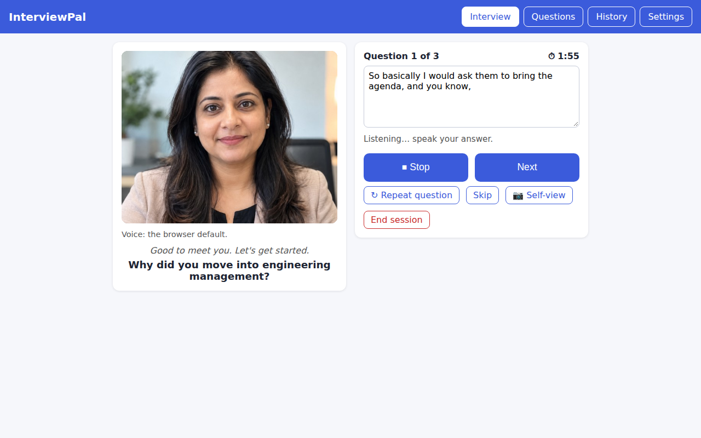
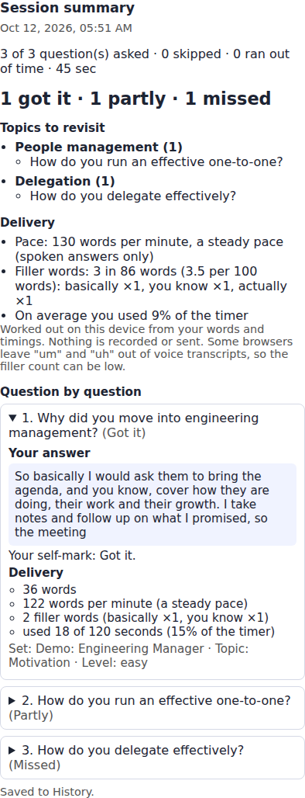
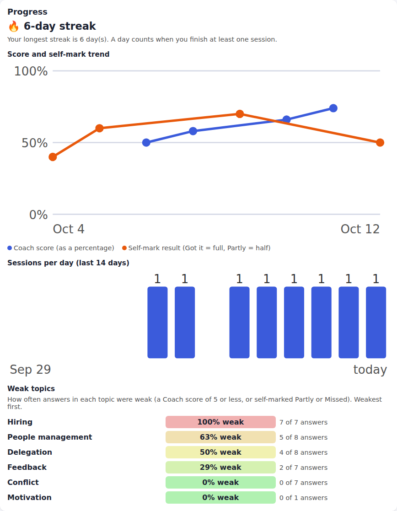

# InterviewPal

**InterviewPal is a mock-interview practice tool that you run in your browser.** Load your own questions and model answers (or try the built-in Engineering Manager demo), and a realistic AI-generated interviewer asks them aloud while you answer by voice or typing. Practise with no AI and no account at all, or switch on Coach mode to have Claude score each answer against your own notes. It tracks your pace and filler words, your progress and your weak topics, and everything stays in your browser.

**Live demo:** <https://mehulp.github.io/interview-pal/>

Practice mode works straight away, with no account and no key. Coach mode needs your own Anthropic API key: paste it in Settings and it stays in your browser (it is never in this repository). Your questions and history are saved in your browser only.

| Interview | Summary and delivery | Progress |
|---|---|---|
|  |  |  |

_The screenshots were taken from the app itself. The progress view shows sample sessions, so it has something to draw. The voice transcript and delivery figures come from stand-in speech, because the screenshots were taken without a microphone._

**AI-generated interviewers:** the interviewer pictures are AI-generated, show no real people, and are not covered by the MIT licence. See [assets/interviewers/NOTICE.md](assets/interviewers/NOTICE.md).

It is a plain website (HTML, CSS and JavaScript). There is no server, no login and no build step. Everything you enter stays in your browser.

## Contents

- [Quick start](#quick-start)
- [Start and stop](#start-and-stop)
- [What it does](#what-it-does)
- [How to use it](#how-to-use-it)
- [Writing your notes so they load well](#writing-your-notes-so-they-load-well)
- [Practice and Coach modes](#practice-and-coach-modes)
- [The interviewers](#the-interviewers)
- [Voice, microphone and camera](#voice-microphone-and-camera)
- [Recording your answers](#recording-your-answers)
- [Your data and backups](#your-data-and-backups)
- [Privacy](#privacy)
- [Troubleshooting](#troubleshooting)
- [Publishing on GitHub Pages](#publishing-on-github-pages)
- [Project layout](#project-layout) (and [how it is built](docs/architecture.md), also as a [visual page](https://mehulp.github.io/interview-pal/docs/architecture.html))
- [Known limitations](#known-limitations)
- [Tests](#tests)
- [Changelog and publishing](#changelog-and-publishing)
- [License](#license)

## Quick start

You need Python 3 (only to serve the files) and Google Chrome.

```bash
cd interviewpal
python3 -m http.server 8010
```

Open <http://localhost:8010> in Chrome and allow the microphone when asked.

Prefer one command? See [Start and stop](#start-and-stop) just below.

- Use `localhost` (not an IP address, and not a `file://` page). The microphone and camera only work on `localhost` or on HTTPS.
- Use the same address every time. Your saved questions, history and recordings belong to that exact address, including the port, so `localhost:8010`, `localhost:8000` and `127.0.0.1:8010` do not share them. The start script's default is `http://localhost:8010`.
- On Windows with WSL, run the server inside WSL and open Chrome on the Windows side.

## Start and stop

A small script starts and stops the local server for you, so you do not have to remember the command. It needs only Bash and Python 3.

```bash
scripts/interviewpal.sh start     # start the server, then open Chrome on it
scripts/interviewpal.sh status    # is it running? shows the address and process ID
scripts/interviewpal.sh stop      # stop the server it started
scripts/interviewpal.sh restart   # stop, then start
```

- It works from any folder, because it finds the project from its own location.
- The address is <http://localhost:8010>. To use another port: `PORT=8001 scripts/interviewpal.sh start` (but then your saved data and recordings are those of that address, not this one).
- On Windows with WSL it opens Chrome on the Windows side. If that does not work, or you set `NO_BROWSER=1`, it only prints the address and you open it yourself.
- If the server is already running, `start` says so and does not start a second one. If another program is using the port, it says so and suggests `PORT=`.
- The server listens on this computer only (`127.0.0.1`), not on your network. It tells the browser not to keep old copies of the files, so an ordinary refresh always shows the latest code.
- The process ID and the log are kept in `.run/` (git-ignored). If the server fails to start, the message shows the log path.
- `python3 -m http.server 8010` still works as a manual fallback. Use the same port, so you see the same saved data.

### Shortcut command (optional)

To type just `interviewpal` from any terminal, add this one line to `~/.bashrc`:

```bash
alias interviewpal='/home/mehul/projects/interviewpal/scripts/interviewpal.sh'
```

(Use the real path of your own copy of the project.) It takes effect in a new terminal, or right away after `source ~/.bashrc`. Then `interviewpal start`, `interviewpal status` and `interviewpal stop` work. The alias is only a convenience: the full path to the script always works without it.

## What it does

- **Question sets.** Keep several named sets, for example Leadership and Technical, and mix them in one session.
- **Load your own notes.** `.md`, `.txt`, `.docx` and `.pdf` files, or pasted text. A built-in reader finds the questions and answers, with no AI. You review and edit the list before using it.
- **A realistic interviewer.** Photos or short clips of a real-looking person who blinks, listens and talks. Several interviewers can be installed, and a stern one can be used for hard rounds. The drawn face is the fallback.
- **Spoken questions.** The browser reads each question aloud, in an Indian, US or UK English voice that matches the interviewer.
- **Voice answers** with a live transcript you can correct, or just type.
- **Difficulty.** Easy, medium or hard change the answer timer, the interviewer's tone, the speaking speed, and whether you can repeat or skip a question.
- **Coach mode (optional).** Claude gives a score out of 10, what you covered, what you missed and one tip, compared with your reference answer, and can speak the feedback.
- **Summary and History.** A summary after every session, with topics to revisit, and a History tab of past sessions.
- **Progress view.** On the History tab: a daily streak, your score and self-mark trend, sessions per day and a heat map of your weakest topics. Drawn on your device from your saved history.
- **Delivery figures (voice answers).** Filler words, words per minute and how much of the timer you used, per answer and for the whole session. Worked out on your device from the words and timings; nothing is recorded.
- **Record and replay your answers (optional).** Record yourself answering, with an optional target length, replay it, and keep the attempts you want. They are saved only in this browser, and every attempt can be downloaded as an audio file.
- **Eye-contact practice.** An optional mirrored picture of your own camera, shown only on your screen.

## How to use it

The four tabs at the top are **Interview**, **Questions**, **History** and **Settings**.

1. **Questions tab: add your notes.**
   - New here? The **Try the demo** card at the top adds about 20 sample Engineering Manager questions, with model answers, to a separate set called "Demo: Engineering Manager". It does not change the set you have open, and it offers an **Open demo set** button afterwards. Nothing is downloaded. Once the demo set exists, the card turns into a one-line note.
   - Open a set (the first one is called "My questions"). Use **New set** to create more, such as "Leadership" and "Technical".
   - Choose a file or paste text, then click **Find questions**. They are added to the open set.
   - Check each card. Fix the question or answer, add a topic, tag it **Easy** or **Hard**, or delete it. Text the reader could not place appears under "Not recognised".
   - The same question can be in more than one set (for example your own notes and the demo). Inside one set a question can appear only once: loading a question that is already in the open set skips it, and you are told how many. **Move to set…** on a card moves it. If the other set already has that question, it just leaves this set. When you tick several sets, a question that appears in more than one is asked only once.
2. **Interview tab: set up a session.**
   - Pick a **mode**: Practice (the default) or Coach.
   - Tick the **question sets** to draw from.
   - Choose the **order** (in sequence or random), **question level** (all, only easy, or only hard), **difficulty** and **number of questions**.
   - Pick the **accent** for the interviewer's voice and for your own speech, your **microphone**, and the **interviewer face** (Automatic is the default).
   - Optional: self-marking (Practice), spoken feedback (Coach), **Show model answer with each question** (off by default), self-view, and the on-device recogniser.
   - Click **Start practice** (or **Start coaching**).
3. **During the interview.**
   - You get a short pause, then the interviewer asks the first question. The question also appears as a caption.
   - Press **🎤 Answer** and speak, or just type. The words appear in the box, and you can correct them. Press **Stop** (or just **Next**) when you finish.
   - **Repeat question** and **Skip** are available except on Hard. The timer counts down when the difficulty has one, and the interviewer moves on when it runs out.
   - **Show answer / Hide answer** shows your saved model answer in a panel under the question (it is never read aloud, and the timer keeps running). The button only affects the current session. If you used it, the session is marked in History as "model answer visible", so you can tell those sessions from closed-book ones.
4. **After the session.** You see the summary straight away, and the session is saved to the **History** tab. Open any past session to read your answers and feedback, delete one, or clear the history.

## Writing your notes so they load well

The reader tries these layouts, in this order, and uses the first that fits:

```text
Q: What is a 1:1 meeting? [easy]
A: A regular private meeting with a direct report to ...
Q: How do you handle conflict in your team?
Level: hard
Topic: Leadership
A: I listen to both sides first, then ...
```

```text
## How do you delegate effectively?
Match the task to the person, set a clear outcome, ...

## Describe a time you gave difficult feedback?
I used the SBI model ...
```

```text
1. Why do you want to be an Engineering Manager?
Because I enjoy growing people and ...
2. How do you prioritise a roadmap?
I score items by impact and effort ...
```

- `Question:` and `Answer:` work like `Q:` and `A:`. Bold markers and numbers such as `Q1.` are fine, and answers can run over several lines.
- With headings, a heading that ends in `?` is the question. Other headings become the **topic**.
- `[easy]` or `[hard]` at the end of a question, or a `Level:` line under it, sets the level. A `Topic:` line sets the topic.
- The answer is optional. The interviewer only needs the question. Without an answer, Coach mode judges your reply on general merit, and self-marking has nothing to show.
- Word and PDF files are turned into text first. Word headings and numbered lists work well. PDFs carry no heading information, so use `Q:`/`A:` or numbering there.
- Anything that fits no layout is listed for you to fix by hand, so nothing is silently lost.

## Practice and Coach modes

| | Practice (default) | Coach |
|---|---|---|
| Needs an API key | No | Yes |
| Network calls to an AI service | None | Yes, one per answer |
| Scoring | None. Optional self-marking: Got it, Partly or Missed | Score out of 10, covered, missed and a tip, spoken or text |
| Cost | Free | A few cents per 10-question session on a Sonnet model |

**Difficulty settings**

| | Easy | Medium | Hard |
|---|---|---|---|
| Answer timer | None (optional 5 minutes) | About 2 minutes | About 90 seconds |
| Tone | Warm, encouraging | Neutral, professional | Brisk, challenging |
| Speaking speed | Slower | Normal | Faster |
| Repeat and skip | Allowed | Allowed | Not allowed |

The interviewer's phrases are in `src/phrases.js`, and the rules above are in `src/session.js`. Both are short and easy to adjust.

**Setting up Coach mode**

1. Create an API key in the Anthropic Console. Setting a monthly spend limit for the key is a good idea.
2. Open **Settings**, paste the key (it starts with `sk-ant-`) and click **Save key**.
3. Click **Test connection**. It sends one tiny request and costs a fraction of a cent.
4. On the Interview tab, **Coach** is now available. Without a key it stays greyed out, with a link to Settings.

The model is `claude-sonnet-5-5` by default. You can change it in Settings.

In Coach mode, only the question, your reference answer and your answer are sent to Anthropic. An empty answer scores 0 without a call. If a call fails, you can try again or skip the feedback.

## The interviewers

The face you see comes from `assets/interviewers/`. If nothing is installed, the drawn face is used.

- **Photos.** A few photos of one person with the same framing: a neutral one, an eyes-closed one, and several with the mouth open. The app swaps between them to blink and talk.
- **Video clips.** `listening.mp4` and `talking.mp4`, cross-faded and looped.
- **Matching voice.** Each interviewer can have a voice profile, so a woman gets a female voice.
- **Automatic choice.** An interviewer can be marked for a difficulty (for example the stern one for Hard). The others are picked at random for Easy and Medium.

The full instructions, the file format and the settings are in [assets/interviewers/README.md](assets/interviewers/README.md).

The three interviewers that come with the app are AI-generated and are committed to the repository (see [assets/interviewers/NOTICE.md](assets/interviewers/NOTICE.md)). If you add your own, use AI-generated people or images you have the right to use, never someone's likeness without permission, and list them in the NOTICE file before you commit them.

## Voice, microphone and camera

Speech recognition is the part that depends most on your setup. For the best results:

- **Use a microphone close to your mouth.** A headset beats the laptop's built-in microphone by a wide margin. Pick it in the **Microphone** list on the Interview tab.
- **Run the microphone check** in Settings. It shows which microphone is in use and how loud you are, with plain advice. Nothing is recorded.
- **Bluetooth headsets** switch to a low-quality "Hands-Free" call mode when their microphone is used. If recognition is poor, compare it with a wired headset.
- **Try the other accents.** English (India), (US) and (UK) can behave quite differently for the same voice.
- **Speak at your normal pace.** The microphone stays open through pauses and waits for your last words when you press Next.
- **Optional on-device recogniser** (experimental, Chrome only). A tick box on the Interview tab. It runs on your computer and is given the key terms from each question and answer. If your Chrome or accent does not support it, you are told and the standard recogniser is used.
- **Typing always works**, so you are never stuck.

**Camera self-view** is off by default. Turn it on to see a small mirrored picture of yourself in the corner, which helps you check where you are looking. The camera is used only to show the picture. It never records, saves or sends anything, never uses the microphone, and switches off when the session ends.

**Eye contact tip:** place the window so the interviewer's eyes sit just below your webcam, and look at them while you answer.

**Reduce motion:** if your system has "reduce motion" switched on, the faces stay still and show one picture per state.

## Recording your answers

This is optional. Nothing is recorded unless you press **Record**, and nothing is saved unless you press **Save**.

1. On the Interview tab, once the question has been asked, the **Record your answer** panel is ready. You can first choose a **target length** (off by default; 1 min, 90 sec, 2 min, 3 min or your own number of seconds).
2. Press **Record** and allow the microphone when the browser asks. The panel shows the time so far, the time left for your target, and **which microphone** is being used. When you reach the target it changes colour and says "Target reached", and the recording carries on. A recording stops by itself after 10 minutes.
3. Press **Stop** (or Next, Skip, End session, or switch tab, which also stop it). You can play the recording back, with a slider to jump around.
4. Choose **Save**, **Discard** or **Download**. **Retry** discards it and records again, and is offered only while that same question is still on screen. If you have moved to another question you can still Save, Discard or Download the earlier recording, and the panel tells you which question it belongs to.
5. Your saved attempts show under the question (**Saved recordings for this question**) and in the **Recordings** card on the History tab, with the date, your target length and the real length. You can play, download or delete each one.

Things to know:

- **Where recordings are kept.** In this browser's storage, on this computer, for this exact address (including the port, so use the same address every time). Another address, another browser or another profile has its own recordings.
- **They can be lost.** Clearing your browser's site data deletes them, and a browser can also clear storage when the disk is nearly full. The app asks the browser to keep them (persistent storage) but the browser may say no, and the Recordings card tells you which. **Use Download for any attempt you want to keep.**
- **An unsaved recording is not recovered** after a crash or if the browser is closed. The browser warns you before you leave the page, but that is only a warning.
- **The recording feature does not upload anything.** It is separate from voice answers: when you use the 🎤 **Answer** button, the browser's recogniser works as it always did, and in Chrome that sends your speech to Google. You can use both at once.
- Recordings are not part of **Export sets**. Questions you edit or delete keep their recordings, which stay under the original wording.

## Your data and backups

Everything is stored in this browser, at this address only:

| What | Where it lives | Backed up by Export? |
|---|---|---|
| Question sets | This browser | **Yes**, on the Questions tab |
| Session history | This browser | No |
| Settings | This browser | No |
| API key | This browser | No |
| Recordings (optional) | This browser, in its own storage | No. Use **Download** on each attempt |

- **Export sets** (Questions tab, Backup) saves all sets to `interviewpal-sets-<date>.json`. **Import sets** reads such a file: sets with the same name are merged, new names create new sets, questions already in the set they merge into are skipped, and an invalid file changes nothing.
- Clearing the browser's site data deletes everything above. Export your sets first, and keep your original notes in `my-notes/` (git-ignored).
- The export file contains your notes. Keep it private and out of git (`interviewpal-sets-*.json` is already git-ignored).
- History keeps the latest 200 sessions. It contains your answers, so keep the computer private.

## Privacy

| What | Where it goes |
|---|---|
| Your notes and sets | Nowhere. They stay in your browser. |
| Your answers and history | Nowhere. They stay in your browser. |
| Coach mode feedback | The question, your reference answer and your answer go to the Anthropic API, and only in Coach mode |
| Your API key | Stored in your browser, and sent only to Anthropic with your requests |
| Voice answers | The browser's speech recogniser. **In Chrome this sends your audio to Google's speech service**, which is outside this app. Typing sends nothing. The on-device option avoids this where available. |
| Spoken questions | Read by your browser's voices. |
| Camera self-view | Shown on your screen only. Never recorded or sent. |
| Recordings of your answers (optional) | Saved only if you press Save, in this browser only. The recording feature uploads nothing. (Voice answers are separate, see above.) |
| Delivery figures | Counted on your device from the words and timings, and saved in History. They never use or keep audio. |
| Word and PDF reading | Two libraries (`mammoth`, `pdf.js`) are downloaded from a public CDN when you first load such a file. Your file is not uploaded. |
| Analytics | None. |

## Troubleshooting

- **The microphone does not work.** Use `http://localhost:8010` (not an IP address or a file), allow the microphone in the address bar, and pick the right one in the Microphone list. Voice input needs an internet connection in Chrome.
- **Words are missed or wrong.** Run the microphone check, use a headset close to your mouth, try another accent, and avoid Bluetooth call mode.
- **The interviewer has the wrong voice.** The Interview tab shows which voice was chosen. The match is guessed from the voice's name. Set a name hint in `assets/interviewers/interviewers.json`, as described in its README, or install more voices in your system.
- **Start is greyed out.** No saved question matches your choices. Check the sets you ticked, the question level, and that you have questions on the Questions tab.
- **Coach is greyed out.** Save an API key in Settings.
- **A test of the key fails.** A "rejected" message means a wrong key. "Model not found" means the model name in Settings is wrong. "Too many requests" means a rate or spending limit.
- **The faces do not appear.** The photos or clips must be in `assets/interviewers/<folder>/` and listed in `interviewers.json`. Names are case-sensitive. If the files fail to load, the app shows the drawn face and says so.
- **My questions disappeared.** You may have opened a different address (for example `127.0.0.1` instead of `localhost`), or cleared the browser data. Import your last export.
- **After an update, the page looks old.** Hard refresh with Ctrl+Shift+R.

## Publishing on GitHub Pages

This is optional. It lets you use the app on your phone, over HTTPS. The code lives at <https://github.com/mehulp/interview-pal>; the Pages steps below are for turning the site on.

1. Create a new repository on GitHub and push this project to it:
   ```bash
   git remote add origin https://github.com/mehulp/interview-pal.git
   git push -u origin main --tags
   ```
2. In the repository, open **Settings → Pages**, choose **Deploy from a branch**, then the `main` branch and the `/ (root)` folder, and save. After a minute the site appears at `https://mehulp.github.io/interview-pal/`.

Things to know before you publish:

- **A Pages site is public.** Anyone with the link can open the app. It contains no keys and no notes, so that is safe. Each visitor's data stays in their own browser.
- **A private repository needs a paid GitHub plan for Pages.** On a free plan, make the repository public (safe, for the reason above) or keep running it locally.
- **The interviewer photos and clips are published too.** They are committed to the repository, so anyone can see and download them. They are AI-generated and are described in [assets/interviewers/NOTICE.md](assets/interviewers/NOTICE.md). If you add your own, only commit images you have the right to publish, and list them in the NOTICE file.
- **Your sets will not be there.** Browser storage is separate for each address. Export your sets here and import them on the published site.
- **On the phone,** use the published address (HTTPS). The microphone works there, and typing always works. The layout stacks into one column on small screens, and it has been tried on a real phone and works well.
- Enter your API key on the phone separately, in Settings. Think twice before saving a key on a device you share.

## Project layout

```text
index.html             the page (all four screens)
styles.css             all styles, including the avatar animations
src/
  ui.js                app shell: tabs, avatar
  practice.js          Interview tab: setup, interview loop, summary
  review.js            Questions tab: sets, loading notes, editing, backup
  historyscreen.js     History tab
  progress.js          numbers for the progress view: trend, streak, weak topics
  progressview.js      draws the progress view
  delivery.js          filler words, pace and timer use for answers
  demoset.js           the demo questions
  settings.js          Settings tab: API key, model, microphone check
  recordings.js        recording rules: format, timer, retry rule, names (pure)
  recorder.js          microphone and MediaRecorder (the only file that records)
  recordstore.js       saved recordings in IndexedDB
  recpanel.js          the recorder panel and the shared review panel
  recordingsview.js    the Recordings card and playback
  parser.js            reads files and finds the questions (no AI)
  sets.js              question set rules (no repeats within a set, move, import)
  session.js           question order, difficulty rules, timer
  phrases.js           what the interviewer says, per difficulty
  history.js           session records and the numbers for the summary
  summary.js           draws a session summary
  claude.js            Anthropic API client and the marking prompt (Coach only)
  speech.js            voices and speech recognition
  vocabulary.js        key words that help the recogniser
  miccheck.js          microphone level meter
  selfview.js          the optional camera picture
  avatar.js            the interviewer's face (drawn, photos or clips)
  interviewers.js      reads the installed interviewers
  storage.js           everything saved in the browser
scripts/               interviewpal.sh (start, stop, status, restart) and devserver.py (the local server)
tests/                 unit tests (Node's built-in test runner)
.github/workflows/     the GitHub Action that runs the checks
CHANGELOG.md           what changed in each version
assets/interviewers/   the AI-generated interviewer photos and clips, their README and NOTICE.md
docs/requirements.md   the full requirements and decisions
docs/architecture.md   how it is built and why: diagrams, components, trade-offs
docs/architecture.html the same, as a styled page with drawn diagrams
CLAUDE.md              working notes for building with Claude Code
my-notes/              your private notes (git-ignored)
```

There is no build step. The code is plain JavaScript modules, loaded directly by the page. The only outside code is `mammoth` and `pdf.js`, loaded from a CDN when a Word or PDF file is read.

## Known limitations

- Voice recognition accuracy depends on your microphone, room and accent. A stronger in-browser engine (for example Whisper) is a possible later addition.
- Choosing a microphone for recognition, and the on-device recogniser, need a recent Chrome.
- Whether a voice is male or female is guessed from its name.
- The interviewer's mouth moves in a generic pattern, not in step with the exact words.
- You can edit a question by hand into a duplicate of another question in the same set. It is not blocked, but the repeat is dropped when a session starts.
- History and the API key are not part of any export.
- Tried on a real phone and works well; not yet tested in Safari or on an iPhone.
- Planned for a later version: follow-up questions, weak-area-first ordering, "tidy up with AI" for messy files, a hint button and a panel of interviewers. Weak-area-first ordering is planned together with spaced repetition. See [docs/requirements.md](docs/requirements.md).

## Tests

The pure logic (reader, sets, sessions, history, vocabulary, delivery, progress) has unit tests that need only Node 20 or newer, no install:

```bash
npm run check   # syntax check of every source file
npm test        # the unit tests (node --test tests/*.test.js)
```

A GitHub Action runs both on every push. Voice, microphone and camera behaviour can only be checked in a real browser.

## Changelog and publishing

See [CHANGELOG.md](CHANGELOG.md). Before the first push to GitHub, run through the [pre-publish checklist](docs/pre-publish-checklist.md).

## License

MIT, see [LICENSE](LICENSE). The interviewer images are not covered by it; see [assets/interviewers/NOTICE.md](assets/interviewers/NOTICE.md).
