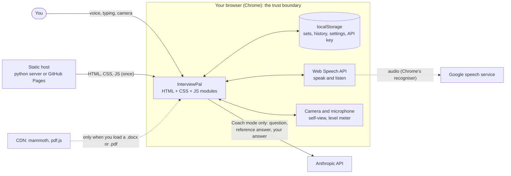
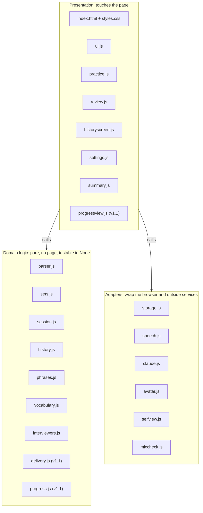
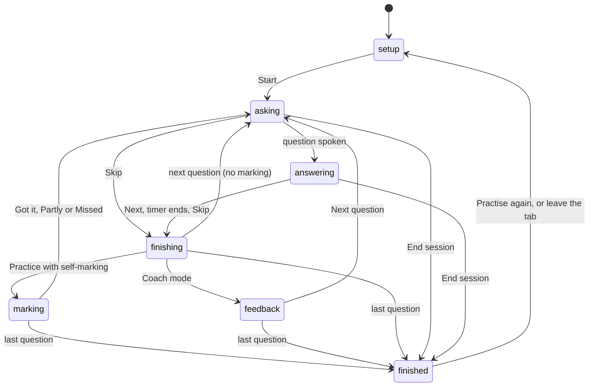
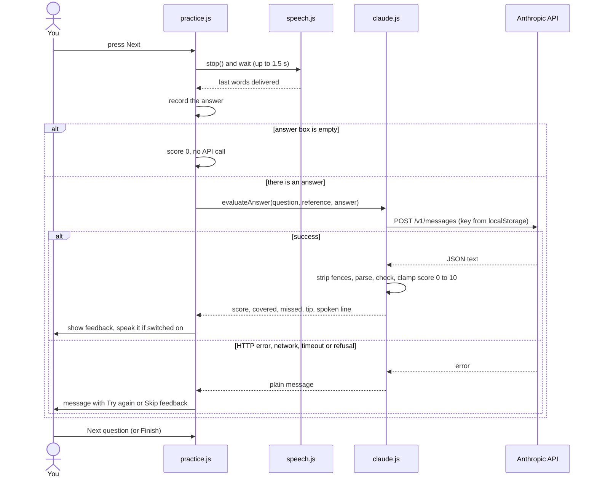
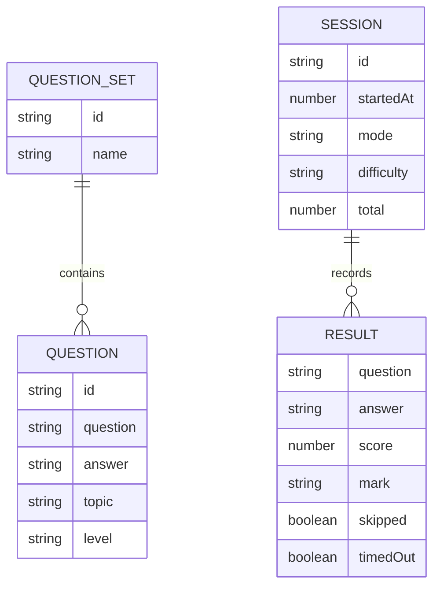
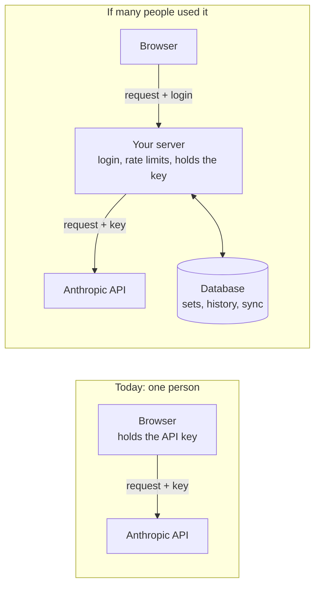

# InterviewPal: architecture

This document explains how InterviewPal is built, why, and what the trade-offs are. For what the app should do, see [requirements.md](requirements.md). For how to use it, see the [README](../README.md).

The diagrams are written in Mermaid, which GitHub draws automatically. A styled, hand-drawn version of the same material is on the [live site](https://mehulp.github.io/interview-pal/docs/architecture.html) (`docs/architecture.html`). If the two differ, this file is the one to trust, and both should be updated together.

## 1. The one-sentence architecture

InterviewPal is a **client-only, static web app**. There is no backend. The browser is the runtime, the database and the user interface, and it talks directly to a few outside services only when a feature needs them. It is about 3,700 lines of code in total.

## 2. System context

The key design decision is where the trust boundary sits. Your notes, answers and history never leave the browser. The only things that cross it are Coach-mode requests to Anthropic and Chrome's voice recognition, which goes to Google.

## 3. Tech stack

| Layer | Choice | Why |
|---|---|---|
| Language | Plain JavaScript (ES modules) | No build step, so the code can be read and run directly |
| UI | One `index.html`, one `styles.css`, no framework | The UI is small. A framework would add weight for little benefit |
| Graphics | Inline SVG (drawn face), `` photo frames, `<video>` clips | Three interchangeable ways to show the interviewer |
| Speech | Web Speech API (`speechSynthesis`, `SpeechRecognition`) | Free, built into Chrome, and typing stays as a fallback |
| Media | `getUserMedia`, Web Audio `AnalyserNode` | Camera self-view and the microphone level meter |
| Storage | `localStorage` | Simple key-value storage, enough for text data |
| AI | Anthropic Messages API, called with `fetch` from the browser | No server of our own to run or secure |
| Documents | `mammoth` (.docx), `pdf.js` (.pdf), loaded from a CDN on demand | Mature libraries that cost nothing unless used |
| Hosting | `python3 -m http.server` locally, GitHub Pages if published | Static files only, so any web server works |

## 4. The code in three layers

This is a "pure core, thin shell" design. The rules that matter (parsing, no duplicate questions, scoring numbers, difficulty rules, who gets picked) sit in small pure modules that can be tested with plain Node scripts and no browser. Everything messy (speech, camera, API, storage) sits behind adapters, so a failure or a missing feature is handled in one place. Domain modules never touch the page or browser APIs, which is what lets `tests/` run them under plain Node (`npm test`, also run by a GitHub Action on every push). Adapters may reuse small domain helpers, such as the shape of a question set.

## 5. The major components

| Component | What it does |
|---|---|
| `practice.js` (about 670 lines) | Owns the interview loop as a small state machine and connects everything else |
| `parser.js` | Reads a file into text (with mammoth or pdf.js for Word and PDF), then tries four layout rules in order. Text it can't place is returned as "unplaced", so nothing is lost |
| `sets.js`, `storage.js` | Sets are `{ id, name, questions[] }`. A question lives in exactly one set, and loading or importing skips duplicates. `storage.js` is the only file that touches `localStorage` |
| `speech.js` | Two halves. Text-to-speech picks a voice by accent and by the interviewer's gender (guessed from the voice name). The recogniser wrapper keeps listening through pauses, joins results with spaces, waits for the last words, and can use a chosen microphone or the on-device mode |
| `avatar.js` | One interface, `setState('idle' \| 'talking' \| 'listening')`, with three ways to draw the face: photo frames, video clips or an SVG. It falls back to the SVG if files fail to load |
| `claude.js` | The API client. It builds the marking prompt (question, reference answer and answer inside tags, JSON-only reply), validates the reply, and turns HTTP errors into plain messages |
| `history.js`, `summary.js` | At the end of a session `buildSessionRecord` takes a snapshot of the results, and `renderSummary` draws it, right after the session and on the History tab |
| `delivery.js` (v1.1) | Pure. From an answer's text, its duration, whether it was spoken or typed, and the timer, works out filler words, words per minute (spoken only) and length against the timer. The numbers are stored in the history snapshot. No audio is kept |
| `progress.js` and a progress view (v1.1) | `progress.js` is pure: it turns stored history into the score trend, sessions per day, a weak-topics heat map and the daily streak. A page module draws them as plain SVG or CSS on the History tab |
| `demoset.js` (v1.1) | The "Try the demo" questions, held as data in the code and loaded through the same import path as a file, so the duplicate rules apply and no network call is made |

## 6. The interview as a state machine

Two details keep this safe:

- **`finishing`** is a short phase while the app waits (up to about 1.5 seconds) for the last spoken words to arrive. It blocks double clicks.
- **An "epoch token".** Every question run gets an id (`runId`). If the user skips, ends the session or the timer fires, any older waiting code sees a stale id and quietly stops. The recogniser uses the same idea (`sessionId`), so an old timeout can't end a newer listening session.

## 7. One Coach answer, end to end

At the end of the session, `history.js` builds one record and `storage.js` saves it.

## 8. Data model

From v1.1 a result also stores `spoken` (true or false), the answer's duration and a `delivery` object (filler count, words per minute, length against the timer). Records saved before v1.1 have none of these and still display.

A session result is a **copy** of what happened (a snapshot), not a link to the question. Editing or deleting a question later does not rewrite history.

Everything is stored in `localStorage` under four keys, for this browser and this address only:

| Key | What it holds |
|---|---|
| `interviewpal.settings` | Choices such as mode, difficulty, accents, microphone, interviewer, model name |
| `interviewpal.sets` | The question sets and their questions |
| `interviewpal.history` | Finished sessions, including your answers (latest 200). From v1.1 each result also carries delivery numbers and whether it was spoken or typed |
| `interviewpal.apiKey` | The Anthropic API key, if one was saved |

## 9. Design patterns used

| Pattern | Where | What it gives |
|---|---|---|
| Strategy | `avatar.js` (drawn, photo, video faces behind one interface) | New kinds of face without touching the rest of the app |
| Adapter, with graceful degradation | `speech.js`, `storage.js`, `claude.js` | Browser quirks handled in one place, with a fallback when something is missing |
| State machine plus epoch token | `practice.js`, `speech.js` | No race conditions from late timers or late speech results |
| Lazy loading | `claude.js` (dynamic import), mammoth and pdf.js (on demand) | Pay for a feature only when it is used |
| Migrate on read | `storage.js` (old question list becomes a set) | Upgrades without a separate migration step |
| Validate before mutating | `sets.js` import | A bad file can never damage saved data |
| Snapshot | `history.js` | History stays correct when questions change |
| Pure core, thin shell | the layer split above | Logic that can be tested without a browser |
| Safe output | everywhere user text is shown | Text is set with `textContent`, never as HTML, so notes or AI replies can't inject markup |

## 10. Trade-offs, and what would change as the app grows

| Decision | Benefit | Cost or risk | If it grew |
|---|---|---|---|
| No backend | No servers, no running cost, strong privacy | No sync between devices. Clearing browser data deletes everything (hence Export) | Accounts and a database |
| API key in the browser | Simple, fine for one person | Anyone with access to the browser profile can read it | A small proxy server holds the key and adds rate limits |
| Browser speech recognition | Free, live, no setup | Accuracy depends on microphone and accent. Audio goes to Google | Whisper in the browser, or a server-side service |
| `localStorage` | Easy | About 5 MB, text only, synchronous | IndexedDB, or a server |
| Vanilla JS, no framework | Nothing to install, easy to read | `practice.js` has grown large, and DOM updates are manual | Split it up, or adopt a small framework |
| Local photos and clips, committed to the repo (v1.1) | Free, private, and the published site shows them | The repo is a little bigger (about 2 MB), the files are AI-generated and not MIT-licensed (hence `NOTICE.md`), and the mouth doesn't follow the words | A live avatar service (paid) |

Scaling is not a concern, because each user runs their own copy. The costs that grow with use are Anthropic tokens (a few cents per Coach session) and, if images were hosted, bandwidth.

## 11. Failure handling

| Something goes wrong | What the app does |
|---|---|
| The browser stops listening (a pause) | Keeps listening. Gives up with a message only after about a minute of silence or repeated quick failures |
| Microphone blocked or missing | A plain message. Typing always works |
| The matching voice is missing | Uses another English voice, or adjusts the pitch, and says so |
| Anthropic returns an error, times out or refuses | A plain message with Try again or Skip feedback. The session carries on |
| Interviewer photos or clips are missing or fail to load | Shows the drawn face, with a note |
| Storage is blocked or full | The app keeps working and says it could not save. Unreadable saved data is never overwritten |
| A bad import file | Rejected with a message. Nothing is changed |
| The user skips or ends while something is pending | Late results are ignored (epoch token) |
| The user leaves the tab mid-session | The session ends, and what was answered is saved to History |

## 12. Describing it in a system design interview

1. **Requirements.** Practise interviews daily, private, cheap, laptop and phone, and typing must always work.
2. **Key constraint.** A single user, so no backend is needed. That removes whole categories of problems such as authentication, scaling and data protection.
3. **Boundaries.** Say exactly what leaves the device (Coach requests, voice audio) and why.
4. **Failure handling.** For each outside dependency (speech, the API, media, storage), say what the fallback is.
5. **Evolution.** Name the first thing that breaks with growth (the key in the browser, no device sync) and the fix (a proxy and a database).

## 13. Test yourself

1. Where is the trust boundary, and what crosses it?
2. Why is the parsing and set logic kept free of browser code?
3. What problem does the `runId` token solve?
4. Why does a history record copy the question text instead of pointing at the question?
5. What are two things that would have to change before this could be used by many people?
6. Why does pressing Next wait up to 1.5 seconds before taking the answer?
